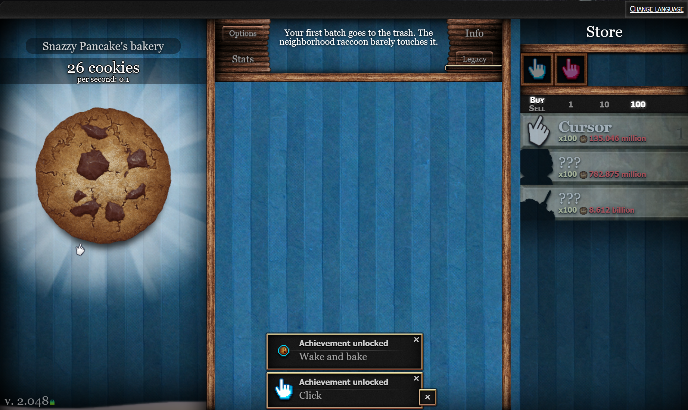

```{r setup, include=FALSE}
knitr::opts_chunk$set(echo = TRUE)
```

## The Best Game Ever
This game is called [Cookie Clicker](https://cookiegame.org/index.html). It is the best ever.

  


## R Markdown

This is an R Markdown document. Markdown is a simple formatting syntax for authoring HTML, PDF, and MS Word documents. For more details on using R Markdown see <http://rmarkdown.rstudio.com>.

When you click the **Knit** button a document will be generated that includes both content as well as the output of any embedded R code chunks within the document. You can embed an R code chunk like this:

```{r cars, echo=FALSE, message=FALSE, warning=FALSE}
library(tidyverse)
car=mpg
car%>%
  ggplot(aes(x=displ,
             y=cty))+
  geom_smooth(method='lm')+
  geom_point()+
  annotate(geom='text',
           x=6,y=30, label='R^2=0.64')
```

## Including Plots

You can also embed plots, for example:

```{r pressure, echo=FALSE}
plot(pressure)
```

Note that the `echo = FALSE` parameter was added to the code chunk to prevent printing of the R code that generated the plot.
